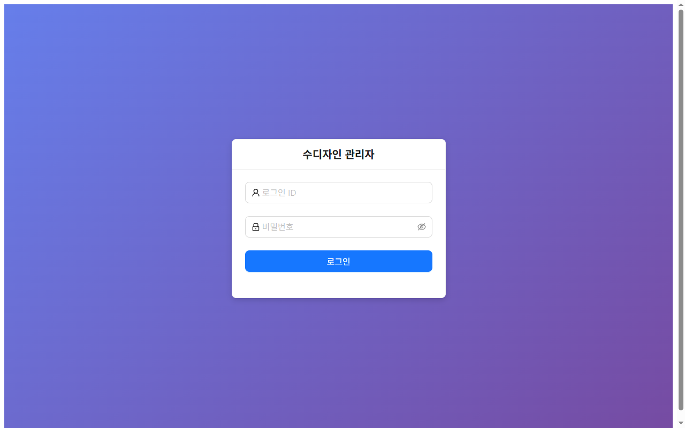
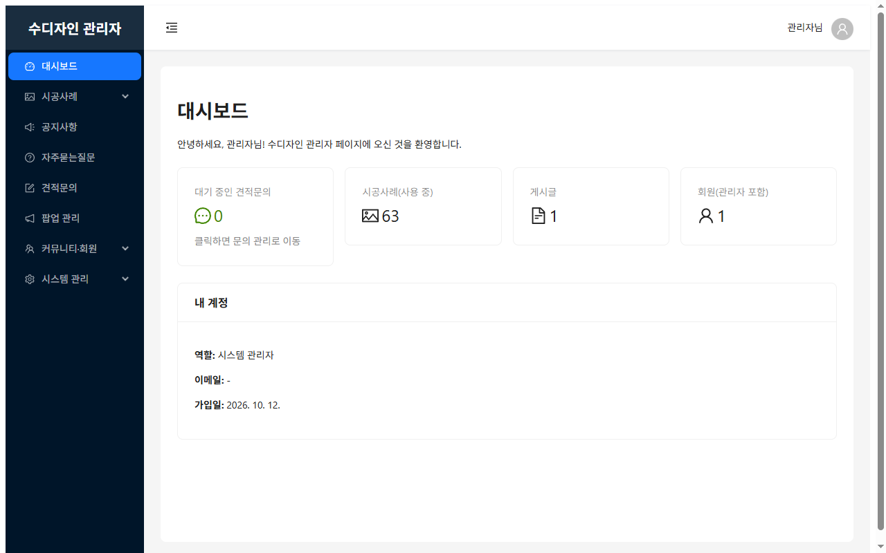
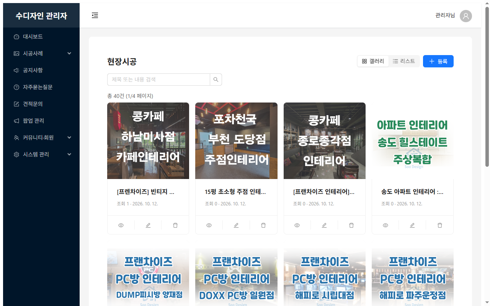
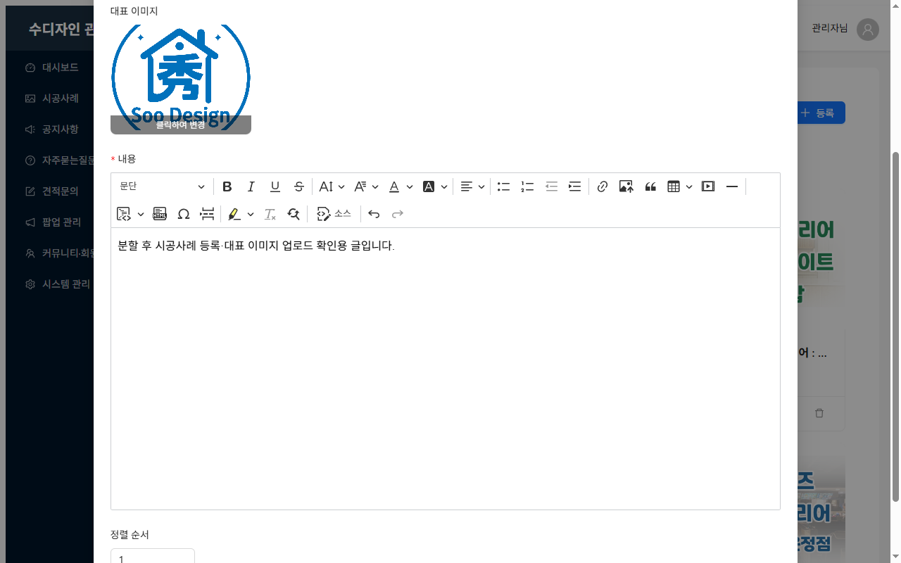
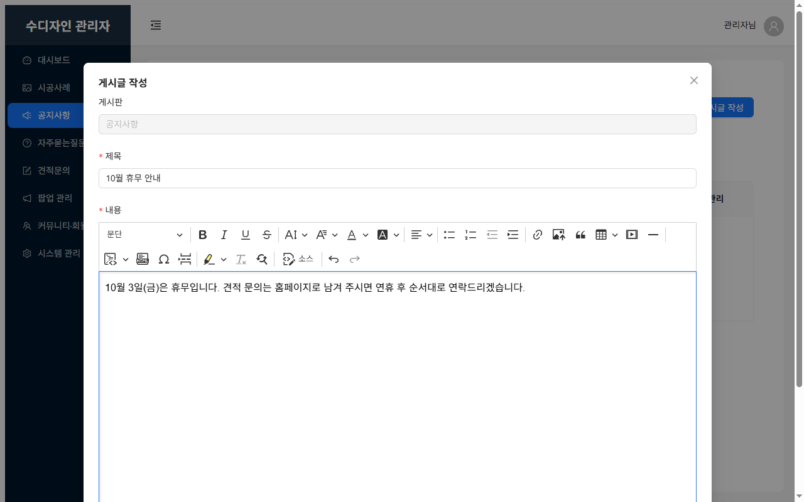
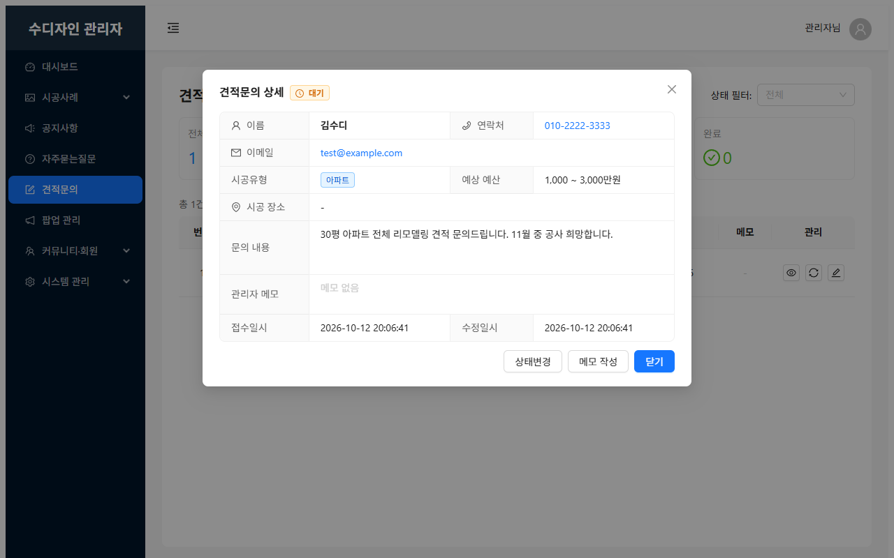
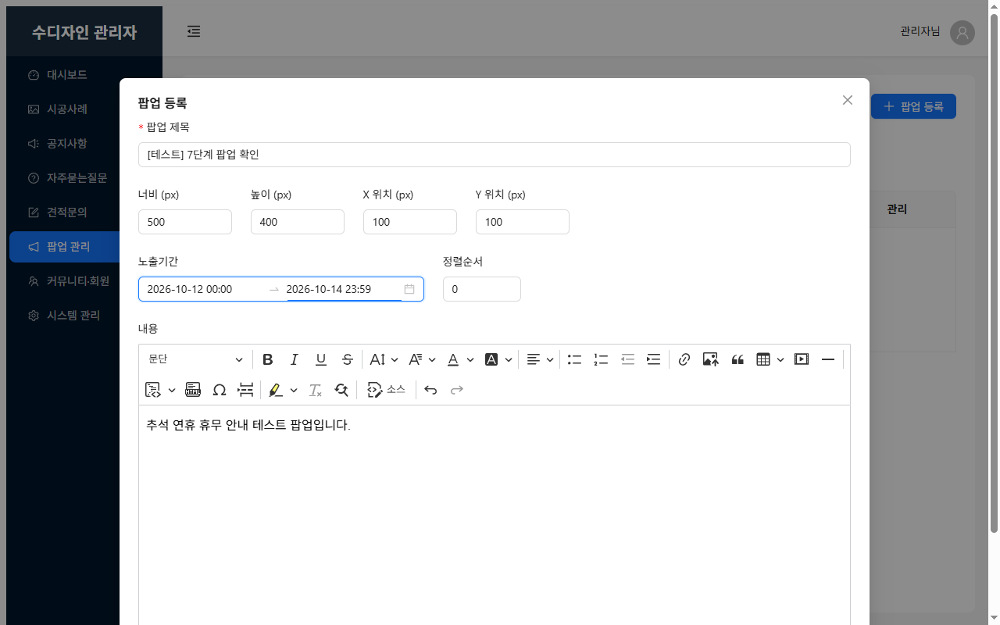

# 수디자인 홈페이지 관리자 사용법 (운영자용)

이 문서는 홈페이지를 직접 운영하는 분(형)을 위한 안내서입니다. 개발 지식 없이 이 문서만 보고 시공사례·공지·견적문의·팝업을 다룰 수 있게 썼습니다. 화면 그림은 2026-10-12 기준입니다.

> 막히면 개발자에게 연락하세요. 특히 **시스템 관리** 메뉴(메뉴·게시판 설정·권한·관리자 계정)는 홈페이지 구조를 바꾸는 곳이라 개발자와 상의한 뒤 만지는 것이 안전합니다.

## 1. 접속과 로그인

1. 인터넷 주소창에 **홈페이지 주소 뒤에 `/admin`** 을 붙여 들어갑니다. (예: `https://홈페이지주소/admin`) 로그인 화면이 뜹니다.
2. 개발자에게 받은 **아이디**와 **비밀번호**를 넣고 **로그인**을 누릅니다.
3. 나갈 때는 화면 오른쪽 위 사람 모양 아이콘 → **로그아웃**.

- 비밀번호를 잊었으면 개발자에게 초기화를 요청하세요. (관리자 스스로 바꾸는 화면은 아직 없습니다.)
- 로그인은 한 시간쯤 지나면 자동으로 풀립니다. 다시 로그인하면 됩니다.

## 2. 화면 구성

왼쪽 메뉴가 전부입니다. 평소에는 위의 여섯 개만 쓰면 됩니다.

| 메뉴 | 하는 일 |
|---|---|
| **대시보드** | 처음 화면. 대기 중인 견적문의 수, 시공사례·게시글·회원 수 |
| **시공사례** | 현장시공 · 셀프시공 팁 · 인테리어스토리 글(사진 포함) 올리기 |
| **공지사항** | 홈페이지 "공지사항"에 보이는 글 |
| **자주묻는질문** | 홈페이지 "자주묻는질문"에 보이는 글 |
| **견적문의** | 고객이 보낸 견적문의 확인·상태 표시·메모 |
| **팝업 관리** | 홈페이지 첫 화면에 뜨는 안내창 |
| 커뮤니티·회원 | 자유게시판 글 관리, 회원 차단 (지금은 홈페이지에서 자유게시판·회원가입을 숨겨 둬서 쓸 일이 거의 없음) |
| 시스템 관리 | (개발자용) 메뉴·게시판 설정·권한·관리자 계정·고정 페이지 |

## 3. 시공사례 올리기 (가장 자주 하는 일)

1. 왼쪽 **시공사례** → 올릴 종류를 고릅니다. **현장시공**(실제 시공 현장), **셀프시공 팁**, **인테리어스토리**.
2. 오른쪽 위 **등록** 버튼을 누릅니다.
3. 입력창을 채웁니다.
   - **제목**: 목록과 홈페이지에 보이는 제목.
   - **대표 이미지**: 목록 카드에 보이는 사진 한 장. 네모 칸을 눌러 컴퓨터(휴대폰)의 사진을 고릅니다.
   - **내용**: 글과 사진. 사진은 편집기 툴바의 **사진 올리기(그림 아이콘)** 버튼으로 넣습니다. 여러 장 넣어도 됩니다. 글은 그냥 타이핑하면 됩니다.
   - **정렬 순서**: 숫자가 작을수록 앞에 나옵니다. 잘 모르면 비워 두세요.
4. **등록**을 누릅니다. 홈페이지의 **인테리어 › 현장시공**(또는 고른 종류)에 바로 보입니다.

- **고치기**: 목록에서 연필 모양(수정) 버튼. 내용을 바꾸고 **수정**.
- **지우기**: 휴지통 모양(삭제) 버튼 → "예". **지운 글은 되돌릴 수 없습니다.**
- 목록 위의 검색창에 제목 일부를 넣고 Enter 를 치면 찾을 수 있습니다.
- 사진 한 장은 **10MB 이하**, 형식은 jpg·png·gif·webp 만 됩니다. 휴대폰 사진은 보통 그대로 올라갑니다.

## 4. 공지사항 · 자주묻는질문 쓰기

1. 왼쪽 **공지사항**(또는 **자주묻는질문**) → **게시글 작성**.
2. **제목**과 **내용**을 씁니다. 사진도 시공사례와 같은 방법으로 넣을 수 있습니다.
3. **공지글** 스위치를 켜면 목록에 빨간 "공지" 표시가 붙습니다. 중요한 안내만 켜세요.
4. **작성**을 누릅니다. 홈페이지의 같은 이름 메뉴에 바로 보입니다.

고치기·지우기는 시공사례와 같습니다(연필·휴지통). 눈 모양 버튼은 내용을 미리 보는 것입니다.

## 5. 견적문의 확인하기

고객이 홈페이지 **견적문의**에서 보낸 내용이 여기 쌓입니다. 새 문의가 오면 **대시보드 첫 칸의 숫자**가 올라가고, 설정돼 있으면 **메일**도 옵니다.

1. 왼쪽 **견적문의** → 목록. 위 칸에 전체·대기·처리중·완료 건수가 보입니다.
2. 한 건을 보려면 **상세 보기**(눈 모양). 이름·연락처·시공 종류·예산·장소·문의 내용이 보입니다.
3. 연락한 뒤에는 **상태 변경**으로 **처리중** → 끝나면 **완료**로 바꿉니다. 그래야 대시보드의 "대기 중" 숫자가 줄어듭니다.
4. 통화 내용 등은 **메모**에 적어 두면 목록에서도 보입니다.

- 고객 연락처는 목록에 바로 보입니다. 문의 자체를 지우는 기능은 없습니다(기록 보관).

## 6. 팝업(첫 화면 안내창) 띄우기와 내리기

휴무 안내, 이벤트 등을 홈페이지 첫 화면에 띄울 때 씁니다.

1. 왼쪽 **팝업 관리** → **등록**.
2. **제목**, **내용**(글·사진), **크기**(가로×세로, 보통 400×500 정도), **위치**(왼쪽 위에서 얼마나 떨어질지), **노출 기간**(시작~끝 날짜), **사용 여부**를 넣고 등록합니다.
3. 기간 안이고 "사용"이면 홈페이지 첫 화면에 뜹니다. 방문자가 **"하루동안 열지 않기"**를 누르면 그 사람에게는 그날 다시 안 뜹니다.
4. **내리려면** 목록에서 **사용 안 함**으로 바꾸거나(또는 삭제) 기간이 끝나면 자동으로 사라집니다.

## 7. 자유게시판 글과 회원 (가끔)

> 2026-10-13 현재 홈페이지에서 자유게시판 메뉴와 회원가입 버튼을 숨겨 두었습니다. 다시 열기로 하면 개발자가 켜 드립니다.

- **커뮤니티·회원 › 자유게시판**: 회원이 쓴 글 목록. 광고·욕설 글은 휴지통으로 지웁니다.
- **커뮤니티·회원 › 회원 관리**: 가입한 회원 목록. 문제가 있는 회원은 **차단**(로그인 불가), 실수면 **해제**. **비밀번호 초기화**도 여기서 합니다.

## 8. 자주 생기는 문제

| 문제 | 해결 |
|---|---|
| 로그인이 안 돼요 | 아이디·비밀번호를 다시 확인. 계속 안 되면 개발자에게 비밀번호 초기화 요청 |
| 사진이 안 올라가요 | 10MB 이하인지, jpg·png·gif·webp 인지 확인. 너무 크면 휴대폰에서 "작게" 보내기로 줄여서 |
| 올렸는데 홈페이지에 안 보여요 | 홈페이지를 **새로고침**(F5). 시공사례는 목록에서 "사용" 상태인지 확인 |
| 화면이 하얗게 뜨거나 "화면을 불러오지 못했습니다"가 떠요 | **새로고침**. 계속 반복되면 개발자에게 |
| 글을 잘못 지웠어요 | 되돌릴 수 없습니다. 삭제 전 확인창에서 한 번 더 보세요 |
| 견적문의 메일이 안 와요 | 메일 알림은 개발자가 설정해야 옵니다. 대시보드 숫자는 설정과 상관없이 올라갑니다 |

## 9. 하지 말아야 할 것

- **시스템 관리 › 게시판 설정**의 "코드"(notice·faq·free)를 바꾸면 홈페이지 메뉴가 깨집니다.
- **시스템 관리 › 메뉴 관리 · 권한 관리**는 관리자 화면 자체를 바꿉니다. 개발자와 상의 후에만.
- 관리자 계정을 여러 사람에게 나눠 줄 때는 **시스템 관리 › 관리자 계정**에서 "운영 관리자"로 만들어 주세요. 시스템 관리자 권한은 개발자만.
